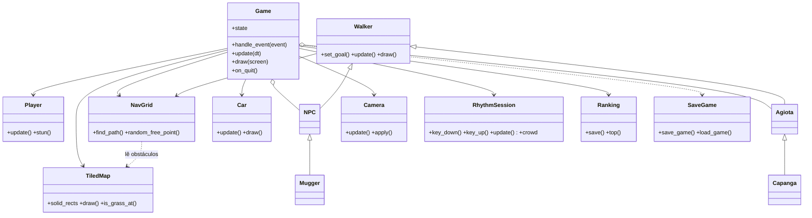

# Song to My Bills — Relatório técnico (rascunho)

## 1. Descrição do jogo

Jogo 2D em Python/Pygame. O jogador tem uma dívida com um agiota que cobra uma parcela todos os dias (dívida e cobrança crescem 50% ao dia). Para pagar, ele explora a cidade (visão de cima, mapa feito no Tiled), compra roupas e toca em três palcos com um minigame de ritmo de 4 pistas (`D F J K`). Quem não paga é caçado pelo agiota e, a cada nova falta, por mais dois capangas; ser pego encerra o jogo. Vence quem quita a dívida, embarca no trem ou sobrevive 30 dias.

| Fase | Locais | Mecânica |
|---|---|---|
| 1 | Cidade, loja, barzinho | Exploração, compras, ritmo livre (Música 1) |
| 2 | Feira musical, casa de shows | Exige roupas; ritmo com **energia da plateia** (Música 2 e Cidade em Pulso): se zerar, o show acaba sem cachê |
| Transversal | Cidade | Caçada do agiota e capangas (A\*), assaltantes noturnos, Fusca dirigível, moradores-obstáculo, ciclo do dia (horários, descanso/cansaço) |

## 2. Diagrama de classes



Conceitos de OO usados: herança (`NPC` e `Agiota` herdam de `Walker`), encapsulamento (a sessão de ritmo guarda estado e julgamento; a grade de navegação esconde o A\*), composição (`Game` compõe mapa, jogador, câmera, ranking) e polimorfismo (`Walker.draw` é desenhado por cada subclasse; o `Game` ordena e desenha todos do mesmo jeito).

## 3. Banco de dados (SQLite)

Arquivo `data/ranking.db`, criado automaticamente por `ranking.py`.

```sql
CREATE TABLE ranking (
    id          INTEGER PRIMARY KEY AUTOINCREMENT,
    nome        TEXT    NOT NULL,   -- até 16 caracteres, espaços normalizados
    pontuacao   INTEGER NOT NULL,
    dias        INTEGER NOT NULL,
    dificuldade TEXT    NOT NULL,   -- Fácil | Normal | Difícil
    resultado   TEXT    NOT NULL,   -- vitória | derrota
    criado_em   TEXT    NOT NULL    -- data/hora local
);
```

- `save()` grava com consulta parametrizada (sem SQL injection) e devolve `True/False`;
- `top(limite, dificuldade)` ordena por pontuação (depois dias) e aceita filtro por dificuldade;
- qualquer `sqlite3.Error` é registrada em `logs/error.log` e o jogo continua sem ranking em vez de travar.

A pontuação vem de: pontos da música (1/10), cachê recebido (1/10) e bônus de vitória (quanto mais cedo e mais dinheiro, mais pontos).

## 4. Logs

`log_setup.py` cria `logs/game.log` (eventos: partidas, compras, apresentações, perseguições) e `logs/error.log` (WARNING ou pior: falha ao carregar assets, beatmaps inválidos, acesso inválido ao banco, save corrompido, exceções não tratadas, inclusive as de fora do loop principal).

## 5. Dificuldades (3 níveis)

| | Fácil | Normal | Difícil |
|---|---|---|---|
| Velocidade (jogador / agiota) | 105% / 150 | 100% / 185 | 97% / 215 |
| Obstáculos (moradores) | 6 | 9 | 13 |
| Tempo limite (fuga do agiota) | 26 s | 20 s | 15 s |
| Nível das fases rítmicas | 1–3 | 2–4 | 3–5 |
| Multiplicador do cachê | 0,85 | 1,00 | 1,25 |

## 6. Principais dificuldades e soluções

| Problema | Solução |
|---|---|
| Músicas de formatos e durações diferentes (um MP3 salvo como `.wav`) | A duração é lida pelo conteúdo (módulo `wave` e, se falhar, o `pygame.mixer`) e comparada ao JSON com tolerância |
| Criar fases rítmicas para cada música é trabalhoso | `tools/make_beatmap.py`: estima BPM e batidas, mede energia por faixa de frequência e escolhe notas por intensidade, gerando 5 níveis aninhados e validados |
| Agiota preso atrás de prédios | A\* sobre uma grade de 32 px; rota refeita a cada 0,35 s |
| Jogador preso por um morador | Moradores sobrepostos ao jogador deixam de ser obstáculo |
| Mapa quebrava em outro computador (tileset em pasta externa) | Imagens movidas para `assets/images/buildings/` e teste automático dos caminhos |
| Perseguidores viravam um "bolo" andando juntos | Papéis diferentes por caçador (direto, cerco pelos lados, interceptação, corte de caminho) e separação entre eles; em simulação, a menor distância entre caçadores após 12 s subiu de 2 px para 144 px |
| Trechos calmos da Música 2 sem notas e final sem notas longas | Ataques "locais" aceitos quando a batida é bem marcada, mínimo de notas por compasso, notas longas com o comprimento do som sustentado e opção de encerramento |
| Prédios que faltavam no mapa | Gerados por código (Pillow) no estilo das casas existentes e inseridos no TMX com a porta virada para cada ponto de interação |
| Desempenho (4.800 células desenhadas por quadro) | Mapa pré-renderizado uma vez; cada quadro só copia a área visível |
| Testes dependiam das configurações salvas do jogador | Testes isolados com configurações, save e ranking temporários |
| Notas sem relação com a música | Diagnóstico mediu até 35% de notas sem ataque real por perto; o gerador passou a exigir um pico de ataque forte a até 45 ms (agora 0–3%) e foi criado um gravador de fases para charts feitos à mão |
| Notas "fora do tempo" (atraso do áudio varia por computador) | Calibração automática: o jogo toca batidas, mede o atraso dos toques (mediana) e compensa; janelas de acerto mais generosas |
| Texto pouco legível | Fonte Poppins embutida e HUD em cartões com contraste |

## 7. Como verificar

Execução: ver `README.md`. Testes: `python -m unittest discover -s tests`.
